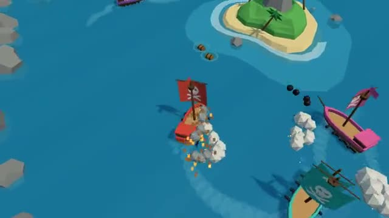

# Pirate Seas

Fire broadsides, sink rivals, sail off with the gold. A multiplayer starter game from [Multiplayer Agent](https://multiplayeragent.com): 3D, drop-in, 2–16 players, with bot captains that fill the sea.

## How it plays

Sail between the islands grabbing floating treasure, and turn side-on to rival ships to hit them with a broadside. Sink a ship and its gold floats up for the taking; get sunk and you lose your haul, but your purse buys ship upgrades that stay with you.

**Controls:** A/D to steer, W/S for sail, click either side of your ship or Q/E to fire; on touch, a thumb stick and tap to fire.

## Make it yours in the Game Builder

Open the [Game Builder](https://multiplayeragent.com), choose **Start from a starter game** and pick Pirate Seas. It opens as version 1 in your studio, ready to play and publish. Then ask for changes, for example:

- Add a sea monster that attacks every ship
- Add a fort on the big island that shoots at ships
- Let players buy a new ship shape in the shipyard

## Run it yourself

1. Get a free publishable key (`pk_…`) at [multiplayeragent.com](https://multiplayeragent.com).
2. In `index.html`, put it in place of `pk_REPLACE_ME` in the `MP_CONNECT` block.
3. Serve the folder (for example `npx serve`) and open it. The 3D engine loads as a module, which browsers block from a file on disk.

Without a key it still runs, offline against bot ships.

## How it is built

- One `index.html` plus three.js in `libs/`. The comment at the top of the script maps the code and explains the multiplayer.
- **Saves:** Your purse, hull, cannon and sail upgrades and best haul are saved for next time.
- **Leaderboard:** The biggest haul one ship carried before it sank.
- **Host-run rules:** The host's browser sails the bot ships, drops the treasure and decides who grabbed it first; if it leaves, the next player takes over.
- **Bots:** Bot captains fill the sea until enough people join.
- **Live sync:** Every ship, broadside and splash shows up for everyone at once.
- **Live ops:** Run a gold rush (more gold in every chest) without touching the code.
- `?attract` runs it offline with bots only. The preview video is recorded from it.

## License

MIT. three.js in `libs/` is MIT too (Copyright 2010-2024 three.js authors).
